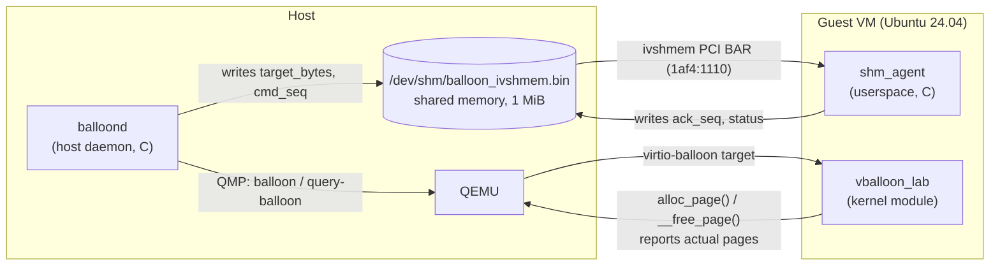

# Virtio-Style Memory Balloon Driver

A memory balloon for QEMU virtual machines, written in C: a Linux kernel module in the guest,
a host daemon that controls it over QMP, and a shared-memory command/acknowledgement protocol
between host and guest.

**Why it matters:** VMs often reserve more RAM than they use. A balloon lets the host take unused
memory back from a running VM, and return it when the VM needs it, without a restart.

## Results

| Capability | Result | Proof |
|---|---|---|
| Inflate (reclaim guest memory) | 3 GiB → 2 GiB, converges exactly | [inflate log](proofs/phase2_qmp_inflate_ok.log) |
| Deflate (return memory) | 2 GiB → 3 GiB, converges exactly | [deflate log](proofs/phase2_qmp_deflate_ok.log) |
| Host control over QMP | `balloon` + `query-balloon`, `qmp_err=0` | [smoke run](proofs/phase3_pressure_run.log) |
| Shared-memory transport (ivshmem, 1 MiB) | Host ↔ guest marker exchange in both directions | [transport log](proofs/phaseC_ivshmem_transport_ok.log) |
| Command/ack protocol | `ack_seq` catches up to `cmd_seq` on every new target | [contract log](proofs/phaseC_ivshmem_contract_run2.log) |
| Duplicate-command guard | Unchanged target with no pending command is not republished | [replay guard log](proofs/phaseB_replay_guard.log) |
| Memory-pressure response | Guest deflates when free RAM falls below a threshold | [dmesg log](proofs/phaseD_pressure_dmesg_fresh.log) |

All logs are indexed in [`proofs/README.md`](proofs/README.md).

## Architecture



1. `balloond` sets a new memory target, publishes it in shared memory with a new `cmd_seq`, and sends it to QEMU over QMP.
2. QEMU passes the target to the guest through the virtio-balloon device.
3. `vballoon_lab` allocates guest pages to inflate (or frees them to deflate) and reports its page count back.
4. `shm_agent` sees the new `cmd_seq` and acknowledges it by writing `ack_seq`.
5. `balloond` polls `query-balloon` until the reported size matches the target.

**Scope note:** the balloon target is applied through QMP and virtio-balloon. The shared-memory
channel carries the command and acknowledgement, and in the guest it is handled by the userspace
`shm_agent`, not by the kernel module directly. Wiring it into the kernel module is listed under
[Future work](#future-work).

## Components

| Path | What it does |
|---|---|
| [`guest/vballoon_lab/vballoon_lab.c`](guest/vballoon_lab/vballoon_lab.c) | Kernel module bound to the virtio-balloon device. Tracks ballooned pages in spinlock-protected lists, inflates with `alloc_page()`, deflates with `__free_page()`, and has a memory-pressure guard (`pressure_enable`, `pressure_min_free_mb`, `pressure_log_interval_ms`). |
| [`host/balloond/`](host/balloond) | Host daemon: QMP Unix-socket client ([`qmp.c`](host/balloond/src/qmp.c)), shared-memory mapping ([`shm.c`](host/balloond/src/shm.c)), command publishing, duplicate guard and telemetry ([`main.c`](host/balloond/src/main.c)). |
| [`guest/shm_agent/main.c`](guest/shm_agent/main.c) | Finds the ivshmem PCI device by vendor/device ID `1af4:1110`, maps its BAR, and acknowledges commands. |
| [`docs/PROTOCOL.md`](docs/PROTOCOL.md) | Shared-memory layout and field ownership (`magic`, `version`, `target_bytes`, `actual_bytes`, `cmd_seq`, `ack_seq`, `status`, `last_error`). |
| [`scripts/`](scripts) | Start QEMU (with or without ivshmem), run the daemon, and run the inflate/deflate smoke test. |

## Requirements

- **Host:** Ubuntu 24.04 (or similar Linux) with QEMU and GCC:
  ```bash
  sudo apt install -y qemu-system-x86 qemu-utils cloud-image-utils socat build-essential git
  ```
- **Guest:** Ubuntu 24.04 cloud image, with `build-essential` and `linux-headers-$(uname -r)` installed inside the VM to build the kernel module.

The scripts use QEMU's TCG accelerator, so KVM is not required.

## Quick Start

```bash
git clone https://github.com/md25052007/Memory-balloon-driver.git
cd Memory-balloon-driver

# 1. Build the host daemon
make -C host/balloond

# 2. Prepare the guest image and cloud-init seed (one time)
#    Full commands: docs/DEMO_DOCUMENTATION.md, sections 2-4

# 3. Start the VM (virtio-balloon + QMP + ivshmem)
./scripts/run_qemu_phase3_ivshmem.sh

# 4. Inside the guest: build and load the module, then start the agent
#    make -C guest/vballoon_lab && sudo insmod guest/vballoon_lab/vballoon_lab.ko
#    make -C guest/shm_agent && sudo ./guest/shm_agent/shm_agent

# 5. Back on the host: run the inflate/deflate smoke test
./scripts/smoke_phase2.sh
```

The scripts find the repository from their own location, so you can clone into any folder.
The complete walkthrough, including binding the module to `virtio0` and capturing proof logs,
is in [`docs/DEMO_DOCUMENTATION.md`](docs/DEMO_DOCUMENTATION.md). A short version for live demos
is in [`docs/DEMO_CHEAT_SHEET.md`](docs/DEMO_CHEAT_SHEET.md).

## Reading the Output

```text
actual=2147483648 target=2147483648 cmd_seq=24 ack_seq=24 shm_status=0 shm_err=0 qmp_err=0
```

| Field | Meaning |
|---|---|
| `actual` | Balloon size reported by QEMU (`query-balloon`), in bytes. This is the convergence measure. |
| `target` | Requested size, in bytes. |
| `cmd_seq` / `ack_seq` | Host command number and the guest's acknowledgement of it. They match once the guest has seen the command. |
| `shm_status`, `shm_err`, `qmp_err` | `0` means no error. |

## Future Work

- Handle the shared-memory command channel inside the kernel module instead of the userspace `shm_agent`.
- A host policy module that sets targets automatically from guest memory statistics.
- Deeper kernel memory-pressure hooks beyond the current threshold check.
- Automatic recovery when QEMU or the agent restarts.

## Documentation

| Document | Contents |
|---|---|
| [`docs/PROJECT_DOCUMENTATION.md`](docs/PROJECT_DOCUMENTATION.md) | Full design and implementation write-up |
| [`docs/DEMO_DOCUMENTATION.md`](docs/DEMO_DOCUMENTATION.md) | Step-by-step reproduction |
| [`docs/DEMO_CHEAT_SHEET.md`](docs/DEMO_CHEAT_SHEET.md) | Minimal live-demo runbook |
| [`docs/END_TO_END_REPORT.md`](docs/END_TO_END_REPORT.md) | End-to-end test report |
| [`docs/STATUS.md`](docs/STATUS.md) | Status and known limitations |
| [`docs/PROTOCOL.md`](docs/PROTOCOL.md) | Shared-memory protocol |
| [`docs/QEMU_TEST_GUIDE.md`](docs/QEMU_TEST_GUIDE.md) | QEMU testing notes |

## License

GPL-2.0. See [LICENSE](LICENSE). The kernel module declares `MODULE_LICENSE("GPL")`.
